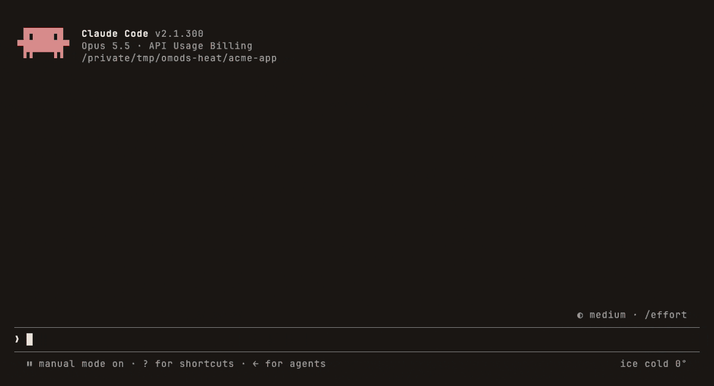
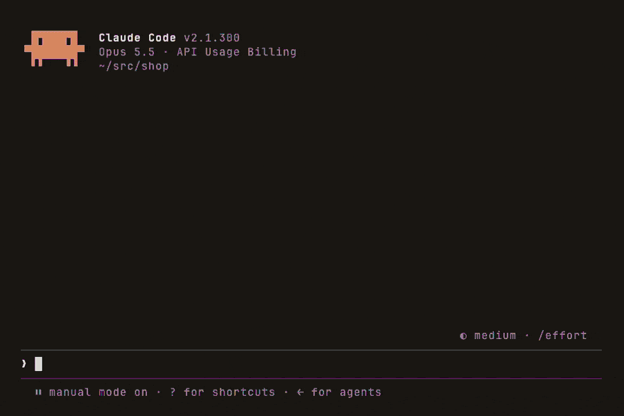
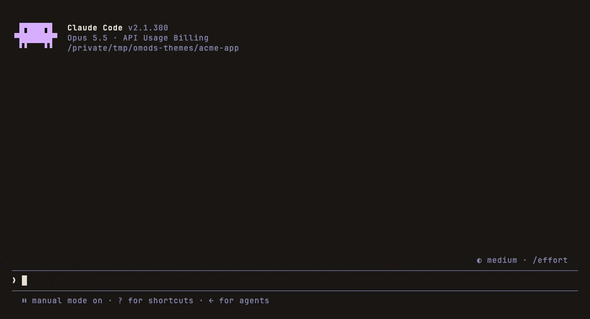
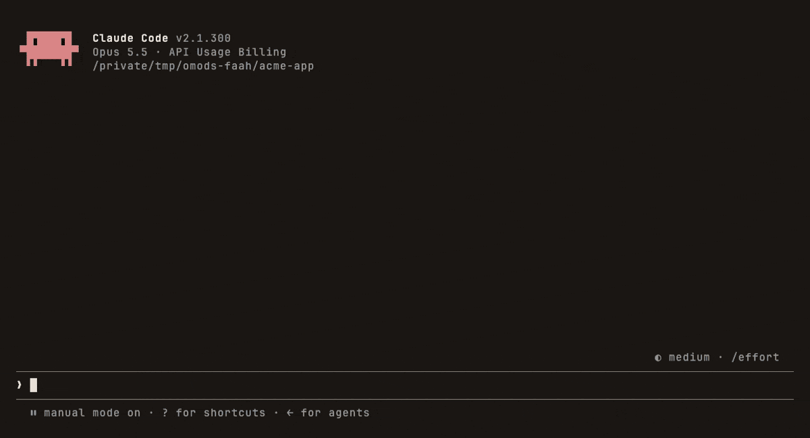
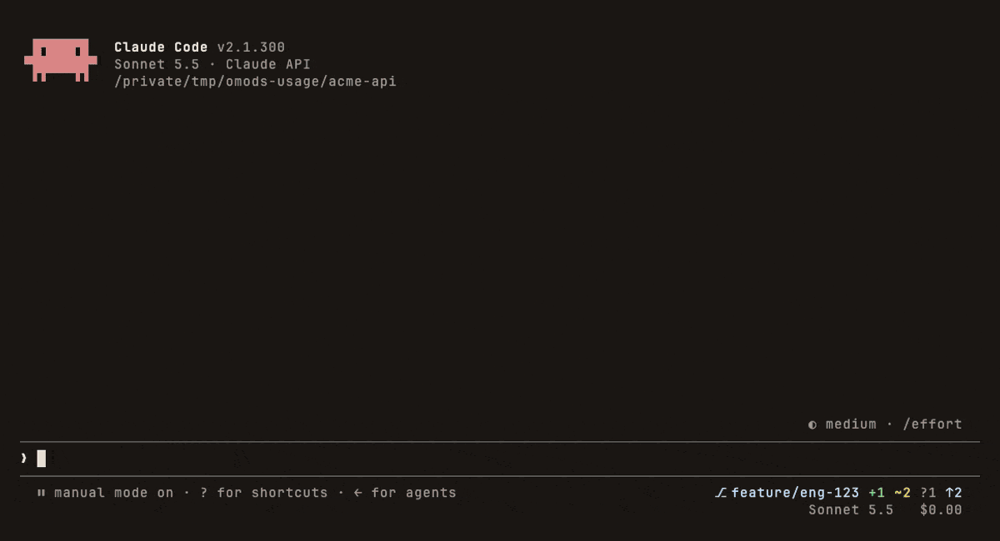
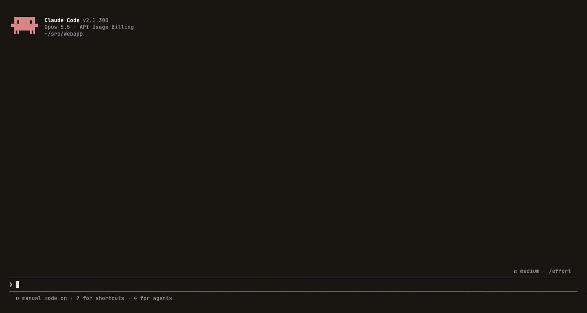
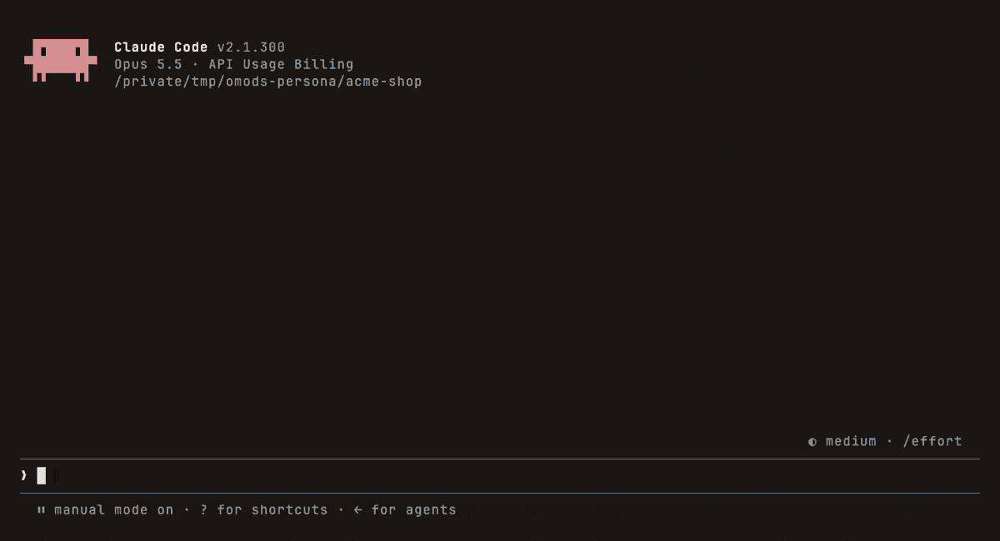
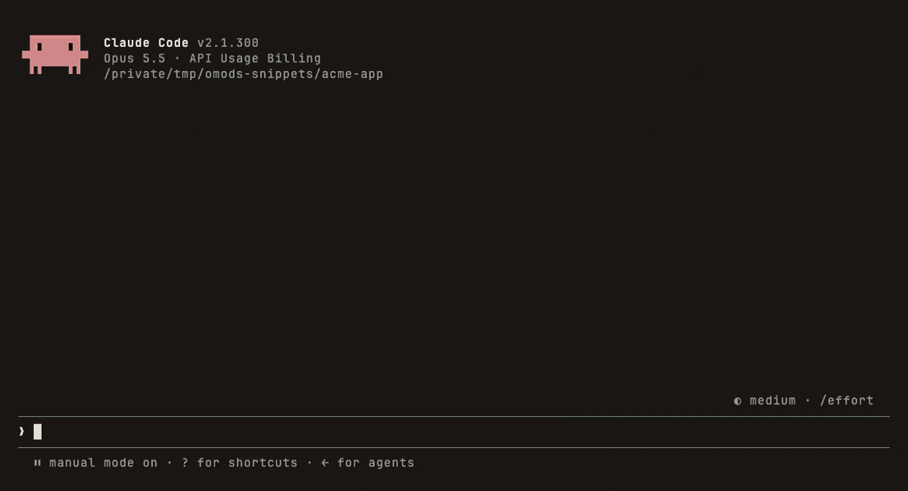
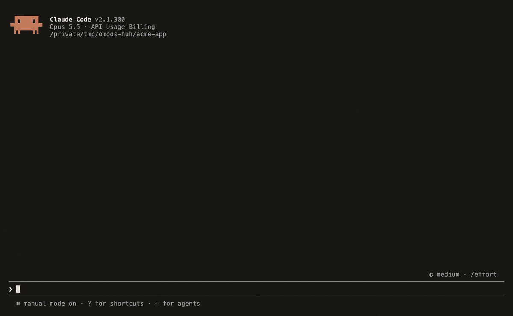
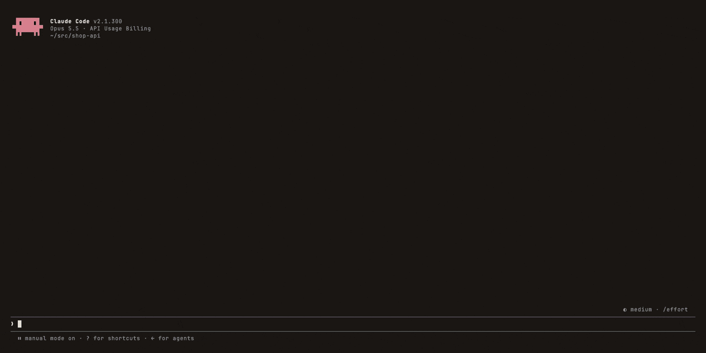

<div align="center">

# o-mods

**Mods for Claude Code.** Sidebars, status bars, animations and hooks that run inside your Claude Code sessions.<br>
Open source. Each one installs with one command.

[**Browse the mods →**](https://omeerdvrn.github.io/o-mods/) &nbsp;·&nbsp; [Install](#install) &nbsp;·&nbsp; [Build your own](CONTRIBUTING.md)



</div>

## Install

```
claude plugin marketplace add omeerdvrn/o-mods
claude plugin install heat@o-mods
```

Run these in a terminal. The first line is needed only once; then install any mod by its name. Mods load in every session, including the desktop app's Code tab. Run `/reload-plugins` in a session that is already open.

Mods need Claude Code 2.1.29x or later (`claude --version`; `claude update`).

## The mods

Every demo below is the real mod running in the Claude Code CLI, with example data.

### For fun

<table>
<tr>
<td width="50%" valign="top">

#### [heat](mods/heat)
NBA-Jam-style heat. Quick prompts and tool calls heat you up, idle time cools you down, and once you're hot a fire burst rises above the prompt.


</td>
<td width="50%" valign="top">

#### [scenes](mods/scenes)
Animated pixel scenes above the prompt while Claude works: night drive, fish tank, campfire, matrix rain and more. Confetti when tests pass, and a crab that acts out what Claude does.



</td>
</tr>
<tr>
<td width="50%" valign="top">

#### [themes](mods/themes)
Color themes for the Claude UI: Catppuccin, Tokyo Night, Gruvbox, Nord, Dracula, Rosé Pine and more. Each new session opens in the next one, so sessions are easy to tell apart.



</td>
<td width="50%" valign="top">

#### [faah](mods/faah)
Meme sounds on events: **FAAAH** when tests fail, **anime wow** when they pass, **bruh** when Claude asks you something. Add more events, or your own clips. *(The demo is silent; your terminal won't be.)*



</td>
</tr>
</table>

### Know where you stand

<table>
<tr>
<td width="50%" valign="top">

#### [usage-bar](mods/usage-bar)
Your 5-hour and weekly plan limits under the prompt, with when they reset, next to the branch, the model, context use and cost.



</td>
<td width="50%" valign="top">

#### [pr-status](mods/pr-status)
The current branch's pull request and its CI checks, live above the prompt. When a check fails, the input suggests fixing it: press Tab. GitHub, GitLab, Gitea, Bitbucket and Azure DevOps.


</td>
</tr>
<tr>
<td width="50%" valign="top">

#### [usage-stats](mods/usage-stats)
`/usage-stats` opens a receipt of your Claude Code usage on this machine: tokens, prompts, sessions, issues closed, daily activity, and tokens by project and model.



</td>
<td width="50%" valign="top">

#### [persona](mods/persona)
`/persona ui-ux` (or backend, qa, docs, pm…) sets the role Claude works in. Edits outside the role are blocked, and the Claude crab under the prompt dresses for the part.



</td>
</tr>
</table>

### Work faster

<table>
<tr>
<td width="50%" valign="top">

#### [linear](mods/linear)
Your assigned Linear issues in a sidebar, grouped by status. **Start** makes a git worktree for an issue and has Claude implement it.


</td>
<td width="50%" valign="top">

#### [snippets](mods/snippets)
A smarter input bar: Linear tickets in the typeahead, live highlighting of paths, tickets and @mentions, secrets flagged in red before you send them, and `;;snippets` that expand as you type.



</td>
</tr>
<tr>
<td width="50%" valign="top">

#### [huh](mods/huh)
`/huh` opens Claude's last answer in the sidebar, rewritten to be easy to read: a short summary first, clear sections, every fact and code block kept. In kitty, Ghostty, WezTerm or iTerm2 it's typeset like a web page.



</td>
<td width="50%" valign="top">

#### [task-router](mods/task-router)
Routes each task to a subagent on the right model (Haiku, Sonnet or Opus) by rules you own, escalates failures one tier up, and shows every model's work in a `/route-status` sidebar. Works with Superpowers.



</td>
</tr>
</table>

Each mod's page has its commands, settings and requirements: click its name, or [browse them on the site](https://omeerdvrn.github.io/o-mods/).

## Update or remove

```
claude plugin update <mod>
claude plugin uninstall <mod>
```

Then `/reload-plugins` in any open session. Settings: `/plugin`.

## Build a mod

Mods are Claude Code plugins with a hooks module: they can draw panes, sidebars and bands, add slash commands, and react to prompts and tool calls. New mods and improvements are welcome. [CONTRIBUTING.md](CONTRIBUTING.md) covers adding one, developing it against a local clone, and recording its demo, which runs against a local mock of the Claude API so it needs no account.

```
o-mods/
├── .claude-plugin/marketplace.json   # every mod in the marketplace
├── mods/<mod>/                       # one folder per mod: plugin, hooks, tests, demo, README
├── demo/                             # the demo recorder and mock API
└── site/                             # the showcase site, built from the mods' READMEs
```

## License

[MIT](LICENSE). A community project, not affiliated with Anthropic.
