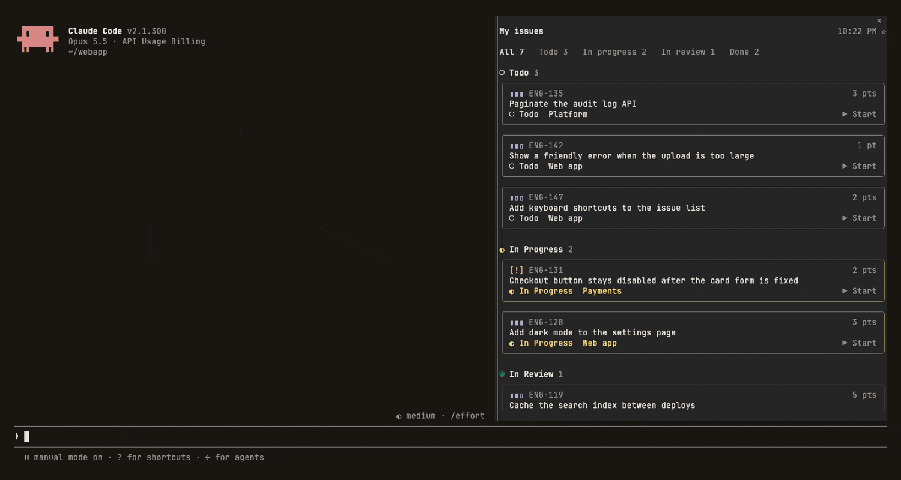

# linear

A Claude Code mod that shows the Linear issues assigned to you in a sidebar. Press **Start** on an issue to create a git worktree for it and have Claude implement it there.



```
My issues                               15:47 ⟳

All 51   Todo 25   In progress 9   In review 4   Done 44

◐ In Progress 9
╭────────────────────────────────────────────────╮
│ ▮▮▮ ENG-1930                             3 pts │
│ Login page ignores the remember-me checkb…     │
│ ◐ In Progress  Acme                    ▶ Start │
╰────────────────────────────────────────────────╯
```

## Features

- Cards for your assigned issues, grouped by Linear status and colored like Linear: priority, ID, estimate, title, status, project.
- Filters: **All** open issues, **Todo**, **In progress**, **In review**, and **Done** (finished in the last 30 days).
- Click a card's title to see the full issue: status, priority, estimate, project, team, due date, labels, branch, and the description.
- **Start** creates a worktree at `<repo>/.claude/worktrees/<issue-id>` on the branch name Linear suggests, moves the issue to In Progress, and starts the implementation.
- Syncs on start and every 5 minutes. `/linear refresh` syncs on demand.

## Requirements

- Claude Code with function-hook mods (2.1.29x or later). The mod API is in early access, so check the mod after major Claude Code updates.
- Linear connected to Claude: the claude.ai Linear connector, or your own Linear MCP server. Run `/mcp` to check.
- For the docked sidebar: `"tui": "fullscreen"` in `~/.claude/settings.json` and a terminal at least 144 columns wide. On narrower terminals, type `/linear` to open it.

## Install

In a terminal, run:

```
claude plugin marketplace add omeerdvrn/o-mods
claude plugin install linear@o-mods
```

The first command adds the marketplace and is needed only once. Mods install at user scope, so they load in every session, including the desktop app's Code tab; add `--scope project` to install one for the current repository only. Run `/reload-plugins` in any open session to load it there.

## Use

| Action | How |
| --- | --- |
| Open the sidebar | It opens by itself on wide terminals, or type `/linear` |
| Sync now | Press `⟳`, or type `/linear refresh` |
| Filter | Press **All**, **Todo**, **In progress**, **In review**, or **Done** |
| See an issue in full | Click its title. Press `✕` to close it. |
| Start work | Press **▶ Start** on the card |

## Settings

Change these in `/config` under `linear`.

| Setting | Default | What it does |
| --- | --- | --- |
| `repoPath` | session folder | The git repository to create worktrees in. |
| `baseRef` | `HEAD` | The branch or commit that new issue branches start from. |
| `startMode` | `session` | `session`: this session switches into the worktree and implements the issue. `agent`: a background agent implements it in the worktree. |
| `moveToInProgress` | `true` | Sets the issue to In Progress in Linear when you press Start. |
| `linearServer` | `claude.ai Linear` | The name of your Linear MCP server, as `/mcp` lists it. |
| `statusColors` | empty | Colors for custom statuses, as `Name=#HEX` pairs: `Blocked=#EB5757, Test=#26B5CE`. |

Linear's MCP server does not return status colors. The mod uses Linear's default colors for the standard statuses (Triage, Backlog, Todo, In Progress, In Review, Done, Canceled). Set `statusColors` for any custom statuses.

Add `.claude/worktrees/` to the `.gitignore` of the repositories you use this with.

## Development

Run the mod from a local clone:

```
claude --plugin-dir /path/to/o-mods/mods/linear
```

The session reloads the mod when you save a file. To check your changes, run these from this folder:

```
claude plugin validate .
claude plugin test .
```

| File | Contents |
| --- | --- |
| `hooks/register.tsx` | Hooks: sync, the `/linear` command, Start, and the sidebar UI |
| `hooks/linear.ts` | Linear data parsing, worktree paths, and the implementation brief |
| `hooks/look.ts` | Status colors and icons, priority icons, estimates, and due dates |
| `types/index.d.ts` | The mod's state contract |
| `tests/sidebar.test.ts` | Tests that run with Linear and git faked |

To release an update, increase `version` in `.claude-plugin/plugin.json` and push. Users then run `claude plugin update linear` and `/reload-plugins`.
