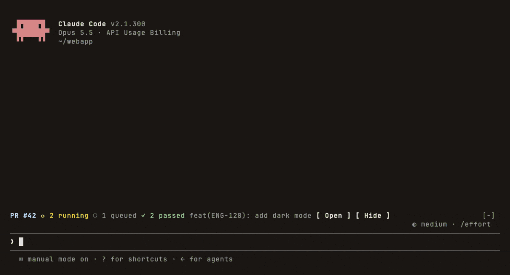

# pr-status

Shows the CI status of the current branch's pull request in a band above the prompt. The band appears as soon as the branch has an open PR, counts its checks by state, and updates while they run:



```
PR #842  ✗ 1 failed  ⟳ 2 running  ○ 1 queued  ✓ 8 passed  feat(ENG-3331): parity follow-ups   [ Open ] [ Hide ]
  failing: CI / integration (pull_request)
```

A toast tells you when CI finishes, passed or failed.

## Forges

The mod reads the branch's upstream remote (or `origin`) and detects the forge on its own:

| Forge | How it reads the PR | Credentials |
| --- | --- | --- |
| GitHub, GitHub Enterprise | `gh pr view`, or the REST API | `gh auth login`, or `GH_TOKEN`/`GITHUB_TOKEN` |
| GitLab, self-hosted GitLab | `glab api`, or the REST API: the MR's head pipeline jobs | `glab auth login`, or `GITLAB_TOKEN`/`GL_TOKEN` |
| Gitea, Forgejo, Codeberg | `tea pulls list`, or the REST API: commit statuses (Gitea Actions report here) | `tea login add`, or `GITEA_TOKEN`/`FORGEJO_TOKEN`/`CODEBERG_TOKEN` |
| Bitbucket Cloud | REST API: the PR's statuses | `BITBUCKET_TOKEN`, or `BITBUCKET_USERNAME` + `BITBUCKET_APP_PASSWORD`; public repos need none |
| Azure DevOps | REST API: builds of the PR's merge ref and PR statuses | `AZURE_DEVOPS_EXT_PAT` |

Detection, in order:

1. An SSH alias such as `github.com-work` resolves to its real host through `ssh -G`.
2. Well-known hosts: `github.com`, `gitlab.com`, `bitbucket.org`, `dev.azure.com`, `*.visualstudio.com`, `codeberg.org`, and hosts named `github.*`, `gitlab.*`, `gitea.*` or `forgejo.*`.
3. A host that `tea`, `glab` or `gh` is signed in to.
4. A probe of the host's API: `/api/v1/version` (Gitea, Forgejo), `/api/v4/version` (GitLab), `/api/v3/meta` (GitHub Enterprise).

Each host's result is remembered on this machine.

## Check states

| Glyph | State | Includes |
| --- | --- | --- |
| ✓ | passed | success |
| ✗ | failed | failure, error, timed out, action required |
| ⟳ | running | in progress, pending |
| ○ | queued | queued, waiting, created, scheduled |
| ⚠ | warning | Gitea warning, GitLab allowed failure, Azure partially succeeded |
| ⊘ | cancelled | cancelled, stopped, stale |
| – | skipped | skipped, neutral, manual |

When a check is re-run, only its newest result is counted.

## When it updates

- Every 10 seconds while any check is running or queued.
- Every 60 seconds once all checks have settled.
- Every 30 seconds while the branch has no PR, so the band appears shortly after a PR is opened from anywhere.
- Right away after Claude runs `git push`, `git checkout`/`switch`, `gh pr create`, `glab mr create`, `tea pr create`, `az repos pr create`, or a CI re-run, and again 5 seconds later. Also after Claude enters or leaves a worktree.

## Command

```
/pr-status           # refresh, then list every check (failed ones with their links)
/pr-status 123       # pin PR 123 (or #123): the band follows that PR instead of the branch's
/pr-status branch    # follow the branch's open PR again
/pr-status open      # open the PR in the browser
/pr-status hide      # hide the band until the next PR
/pr-status show
```

## Develop

```
claude plugin validate mods/pr-status
claude plugin test mods/pr-status
```
